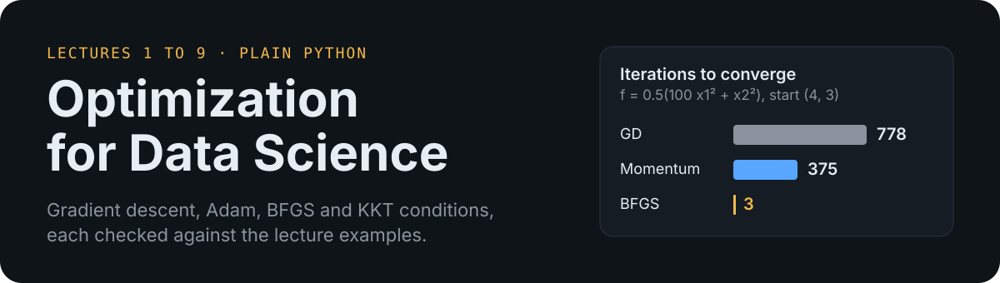
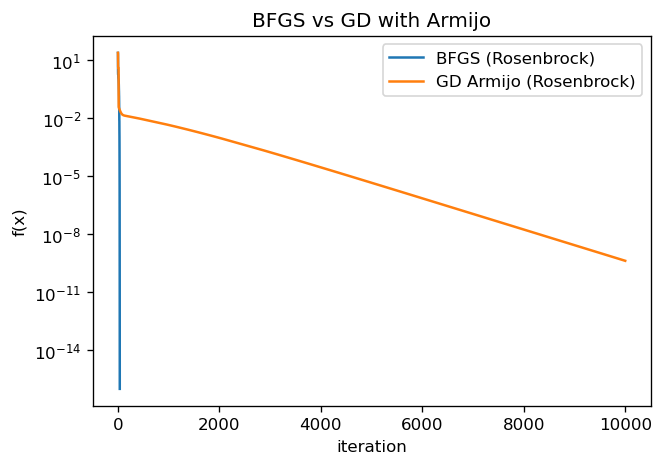
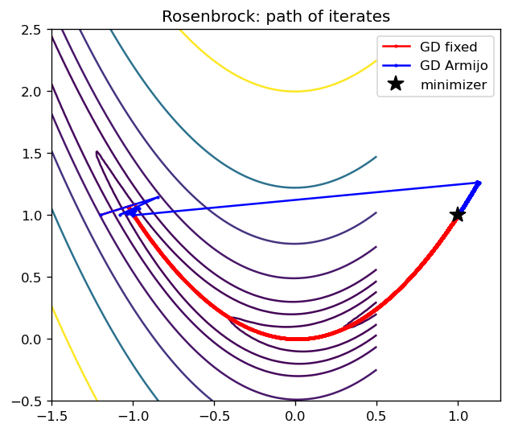
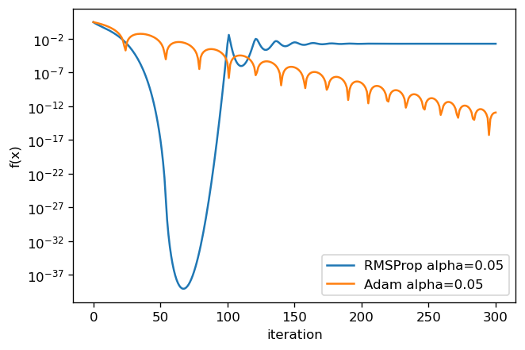
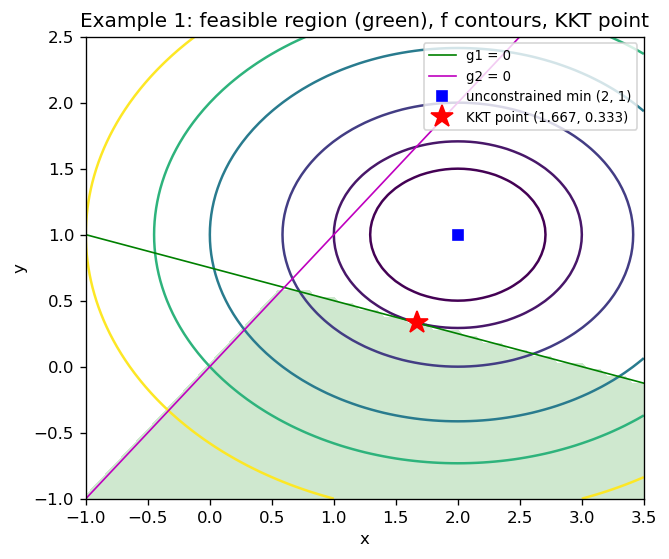

<p align="center">
  
</p>

Every method from the ten Optimization for Data Science lecture PDFs, written from its definition in plain Python with loops. Matplotlib is used only for plots. Each worked example from the slides is run, and the results are checked against the slide numbers. Where the slides contain arithmetic or sign errors, the code follows the stated formulas and the difference is listed in [report.md](report.md).

## What is covered

| Lecture | File | Topic |
| --- | --- | --- |
| 1 | [code/lecture1_intro.py](code/lecture1_intro.py) | Norms, gradients, Hessians, definiteness, Taylor series, peaks minimization |
| 2 | [code/lecture2_gradient_descent.py](code/lecture2_gradient_descent.py) | Gradient descent, exact and Armijo line search, momentum, Nesterov |
| 3 | [code/lecture3_linear_regression.py](code/lecture3_linear_regression.py) | Linear regression, GD, SGD, mini-batch SGD, normal equation |
| 4 | [code/lecture4_logistic_adaptive.py](code/lecture4_logistic_adaptive.py) | Logistic regression, Adagrad, RMSProp, Adam |
| 5 | [code/lecture5_ewma_adam.py](code/lecture5_ewma_adam.py) | EWMA, RMSProp, Adam with bias correction |
| 6 | [code/lecture6_subgradient.py](code/lecture6_subgradient.py) | Subgradients, subgradient method, lasso, hinge loss SVM |
| 7 | [code/lecture7_newton.py](code/lecture7_newton.py) | Newton's method, damped Newton, 1D root and optimum |
| 8 | [code/lecture8_bfgs.py](code/lecture8_bfgs.py) | Secant pairs, inverse BFGS update, curvature check, BFGS |
| 8A | [code/lecture8a_constrained.py](code/lecture8a_constrained.py) | Equality constraints, Lagrange multipliers, KKT Newton solve |
| 9 | [code/lecture9_kkt.py](code/lecture9_kkt.py) | KKT active-set solver and second-order check |

## Results

The figures below come from one full run (`results/20261025_143100/`). Every number is printed in that run's `log.txt`.

**Momentum and BFGS on the same problem.** Rosenbrock from (-1.2, 1). Gradient descent with Armijo backtracking hits the iteration cap, while BFGS converges in 36 iterations.

<p align="center">
  
</p>

**Path of the iterates.** Gradient descent paths on the Rosenbrock function. The fixed-step run and the Armijo run both reach the 10000-iteration cap without converging.

<p align="center">
  
</p>

**Adaptive step sizes.** RMSProp and Adam on f = x1² + 2x2², 300 iterations. Adam reaches f = 1.2e-13 and RMSProp reaches f = 1.9e-3 at the step sizes in the run log.

<p align="center">
  
</p>

**Constrained optimum.** Lecture 9, Example 1. The feasible region and the KKT point at x = (5/3, 1/3) with f = 1.

<p align="center">
  
</p>

Other figures are in `results/20261025_143100/`, including convergence curves for each lecture.

## Run it

Requires Python 3 and matplotlib.

```bash
python3 code/run_all.py
```

Each run writes its figures, tables and `log.txt` to a new `results/<timestamp>/` folder. The seed is set in [code/config.py](code/config.py) and logged in every run.

## Known gaps

The full list is in [report.md](report.md), section 5. In short:

- The secant method from Lecture 7, the Lecture 8 positive and negative curvature illustrations, and the Lecture 6 lasso worked example are not implemented.
- Pearson, Jaccard and Mahalanobis similarities are not implemented because the slides give no formulas for them.
- Lectures 1, 8A and 9 keep some constants in local dictionaries instead of `code/config.py`.
